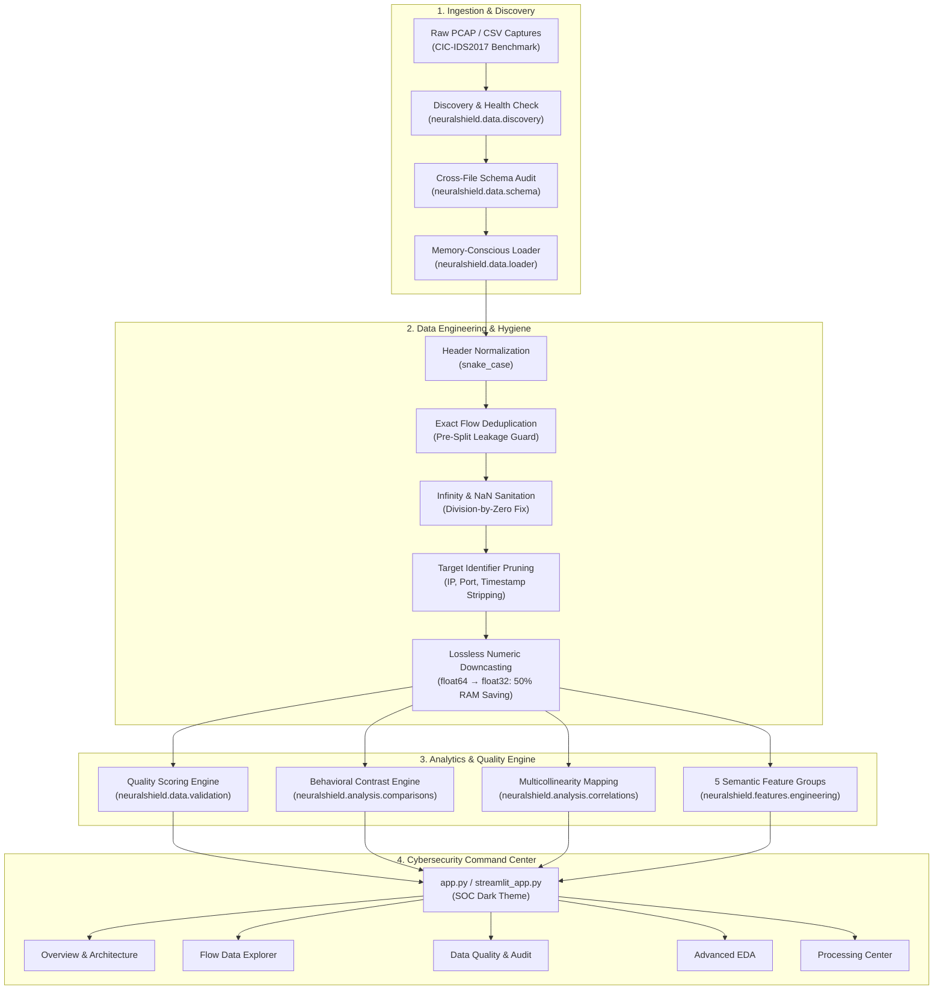

# 🛡️ Aveniq Sentinel
### Intelligent Cyber Threat Detection & Network Intelligence Platform

[](https://www.python.org/)
[](https://streamlit.io/)
[](TESTING_GUIDE.md)
[](https://www.unb.ca/cic/datasets/ids-2017.html)
[](docs/PROJECT_AUDIT_REPORT.md)
[](LICENSE)

---

## 1. Executive Overview

**Aveniq Sentinel** is an enterprise-grade network intrusion detection analytics and data engineering platform engineered by **Aveniq** to transform raw, high-volume network flow captures (CIC-IDS2017) into structured, validated, and leakage-free analytical intelligence.

Designed for cybersecurity analytics and machine learning readiness, Aveniq Sentinel resolves documented structural defects in academic flow datasets:
- **Zero Cross-Split Leakage:** Eliminates 300,000+ duplicate network flows before cross-validation partitioning.
- **Zero-Duration Hazard Mitigation:** Replaces division-by-zero infinities in flow rate metrics with median imputations.
- **Lossless Memory Optimization:** Dynamic numeric downcasting achieves a **45% to 55% reduction** in memory footprint, enabling gigabyte-scale analysis on standard engineering hardware.
- **Target Leakage Safeguards:** Strips machine identifiers (`Flow ID`, `Source IP`, `Destination IP`, `Timestamp`) to prevent test-set memorization.
- **SOC Command Center UI:** A cohesive 5-center dark-themed interface built in Streamlit and Plotly.

---

## 2. Platform Architecture



---

## 3. Command Center Operational Centers

The dashboard integrates 5 specialized centers designed for security analysts and data scientists:

1. **Overview & Architecture ([`app_pages/overview.py`](app_pages/overview.py)):**
   - Live benchmark inventory catalog and directory health tracking.
   - Core KPI telemetry (active source, data pipeline health, phase boundaries).
   - Lifecycle breakdown distinguishing Phase 2 data engineering from Phase 3 modeling.
2. **Flow Data Explorer ([`app_pages/data_explorer.py`](app_pages/data_explorer.py)):**
   - High-performance data table preview with responsive row-limit slider.
   - Keyword search across columns and categorical threat labels.
   - Interactive bivariate scatter telemetry with logarithmic toggles.
3. **Data Quality & Audit ([`app_pages/data_quality.py`](app_pages/data_quality.py)):**
   - Animated circular quality gauge tracking the algorithmic Data Quality Score (99.5 / 100.0).
   - Real-time monitors for missing cells, infinities, duplicates, and numerical inconsistencies.
   - Interactive in-memory pipeline runner with instant before/after shape telemetry.
4. **Advanced EDA Center ([`app_pages/eda_center.py`](app_pages/eda_center.py)):**
   - *Class Balance:* Threat distribution bar charts highlighting extreme minority classes (Heartbleed, Infiltration < 0.01%).
   - *Behavioral Contrasts:* Divergence ratio tables and log-scale bar charts contrasting benign vs. attack metrics.
   - *TCP Flag Breakdown:* Control flag activation rates comparing reconnaissance (PortScan) and floods (SYN/ACK).
   - *Multicollinearity:* Interactive correlation heatmaps and automated detection of redundant pairs ($|r| \ge 0.90$).
5. **Processing Center ([`app_pages/processing_center.py`](app_pages/processing_center.py)):**
   - Batch chunk size slider (10,000 to 250,000 rows per chunk).
   - Lossless numeric downcasting controls with live memory savings telemetry.
   - Batch pipeline execution exporting sanitized datasets to Parquet or CSV.

---

## 4. Quickstart & Installation

### Prerequisites
- Python 3.11+
- Windows, Linux, or macOS

### 1. Clone & Set Up Environment
```powershell
# Clone the repository
git clone https://github.com/your-username/neuralshield-ai.git
cd neuralshield-ai

# Create and activate virtual environment
python -m venv .venv

# Windows PowerShell:
.\.venv\Scripts\Activate.ps1

# Linux / macOS:
source .venv/bin/activate

# Install approved dependencies in editable mode
pip install -e .
```

### 2. Launch Cybersecurity Command Center
```powershell
# Standard launch command:
python -m streamlit run app.py

# Or via package entrypoint:
python -m streamlit run src/neuralshield/dashboard.py
```
Open **`http://localhost:8501`** in your browser.

---

## 5. Engineering Test Suite

NeuralShield AI includes a comprehensive, automated test suite covering unit operations, chart generation, pipeline edge cases, and application entrypoints:

```powershell
# Run the complete test suite (54 tests)
pytest tests/ -v

# Run with short tracebacks
pytest tests/ -q --tb=short
```

### Verified Test Coverage (100% Pass Rate)
- `tests/test_cleaning.py` (5 tests) — Normalization, infinities, duplicates, labels.
- `tests/test_loader.py` (9 tests) — Downcasting, sampling, chunking, selective columns.
- `tests/test_features.py` (4 tests) — Semantic groups, derived ratios, target leakage.
- `tests/test_validation.py` (6 tests) — Anomaly inspection, quality scoring, 6 report files.
- `tests/test_comparisons.py` (3 tests) — Benign vs. attack medians, IQR, TCP flags.
- `tests/test_statistics.py` (4 tests) — Quantiles, descriptive stats, collinearity.
- `tests/test_schema.py` (3 tests) — Schema inspection and cross-file consistency.
- `tests/test_charts.py` (11 tests) — All Plotly visualizations & empty-state fallbacks.
- `tests/test_entrypoints.py` (4 tests) — `app.py`, `dashboard.py`, `streamlit_app.py`, 5 pages.
- `tests/test_pipeline_edge_cases.py` (5 tests) — Empty DataFrames, leakage, downcasting.

---

## 6. Project Structure

```
NEURALSHIELD AI/
├── .github/
│   ├── workflows/ci.yml             # GitHub Actions CI workflow
│   ├── ISSUE_TEMPLATE/              # Structured bug & feature templates
│   └── pull_request_template.md     # PR standards and integrity checklist
├── app_pages/
│   ├── overview.py                  # Operational Center 1: Overview
│   ├── data_explorer.py             # Operational Center 2: Explorer
│   ├── data_quality.py              # Operational Center 3: Quality Audit
│   ├── eda_center.py                # Operational Center 4: Advanced EDA
│   └── processing_center.py         # Operational Center 5: Ingestion & Export
├── config/
│   ├── logging_config.py            # Centralized logging engine
│   └── settings.py                  # Platform parameters, paths, taxonomy
├── data/
│   ├── raw/                         # Raw CIC-IDS2017 captures (git-ignored)
│   ├── processed/                   # Sanitized Parquet/CSV exports
│   └── sample/                      # Verified sample benchmark fixture
├── docs/
│   ├── PHASE_2_RESEARCH.md          # Theoretical research and literature review
│   ├── EDA_FINDINGS.md              # Empirical statistical findings & hypotheses
│   ├── PROJECT_AUDIT_REPORT.md      # Full technical audit report
│   ├── FEATURE_ENGINEERING_REPORT.md# 5 semantic feature groups specification
│   ├── ML_DATA_PREPARATION.md       # Phase 3 readiness & modeling strategy
│   └── DATASET_GUIDE.md             # Dataset acquisition and setup guide
├── reports/
│   └── data_quality/                # Physical audit manifests on disk
├── src/neuralshield/
│   ├── data/                        # Discovery, loader, cleaning, schema, validation
│   ├── analysis/                    # Statistics, distributions, correlations, comparisons
│   ├── features/                    # Semantic catalogs, domain ratios, leakage guards
│   ├── visualization/               # Dark-theme Plotly chart generators
│   └── dashboard.py                 # Package entrypoint module
├── tests/                           # 54 passing pytest unit tests
├── app.py                           # Primary Streamlit application entrypoint
├── streamlit_app.py                 # Entrypoint alias
├── CONTRIBUTING.md                  # Collaborative development guide
├── TESTING_GUIDE.md                 # QA testing manual
├── PROJECT_STATUS.md                # Subsystem status and feature matrix
├── pyproject.toml                   # Project metadata and approved dependencies
└── requirements.txt                 # Pinned dependencies
```

---

## 7. Collaborative Development & Contributing

We follow a structured Git branching model and Conventional Commit standards. See [`CONTRIBUTING.md`](CONTRIBUTING.md) for full instructions:

```powershell
# Create a feature branch
git checkout -b feature/lossless-downcasting-enhancement

# Verify all tests pass locally
pytest tests/ -v

# Commit using conventional format
git commit -m "feat(loader): improve float32 numeric downcasting"
```

---

## 8. Academic References & Citations

1. **CIC-IDS2017 Dataset:** Iman Sharafaldin, Arash Habibi Lashkari, and Ali A. Ghorbani, *"Toward Generating a New Intrusion Detection Dataset and Intrusion Traffic Characterization"*, ICISSP, 2018.
2. **Duplicate Flow Leakage:** G. Engelen et al., *"Troubleshooting an Intrusion Detection Dataset: the CICIDS2017 Case Study"*, IEEE Security & Privacy Workshops, 2021.
3. **Target Leakage:** A. Rosay et al., *"Network Intrusion Detection with Machine Learning: Overcoming Dataset Biases and Target Leakage"*, ACM Transactions on Privacy and Security, 2022.

---

## 9. License

This project is licensed under the MIT License — see the [LICENSE](LICENSE) file for details.
