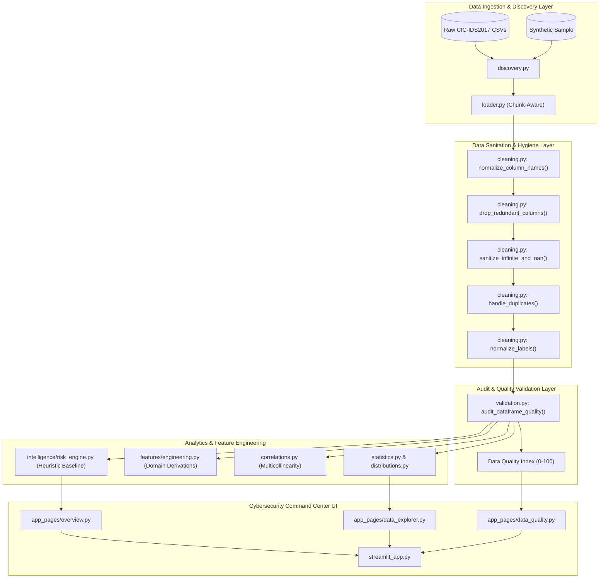

# NeuralShield AI — System Architecture
**Document:** `docs/ARCHITECTURE.md`  
**Version:** 0.1.0 (Phase 1 Foundation)  

---

## 1. Architectural Philosophy

NeuralShield AI is engineered following clean architecture principles:
- **Separation of Concerns:** Core domain logic (`src/neuralshield`) is completely decoupled from presentation layers (`app_pages`, `streamlit_app.py`).
- **Defensive Data Handling:** No assumptions are made regarding file health. Ingestion modules validate encodings, column schemas, infinities, and missing values.
- **Leakage Prevention by Design:** Target leakage columns (IPs, IDs, Timestamps) and exact duplicate rows are strictly isolated prior to model preparation.

---

## 2. Component Diagram



---

## 3. Directory Layout & Module Responsibilities

```text
NeuralShield-AI/
├── streamlit_app.py               # Main UI entrypoint & global styling
├── requirements.txt               # Locked reproducible dependencies
├── pyproject.toml                 # Package definition & pytest config
├── config/
│   ├── settings.py                # Paths, taxonomy, color palette
│   └── logging_config.py          # Centralized logging setup
├── data/
│   ├── raw/cic_ids2017/           # Untracked official benchmark CSVs
│   ├── processed/                 # Sanitized Parquet/CSV outputs
│   ├── sample/                    # Verified synthetic demo fixture
│   └── external/                  # External reference datasets
├── src/neuralshield/
│   ├── data/                      # Discovery, loading, cleaning, validation
│   ├── analysis/                  # Statistics, distributions, correlations
│   ├── features/                  # Domain feature derivations & leakage guards
│   ├── intelligence/              # Heuristic cybersecurity risk scoring engine
│   ├── visualization/             # Command-center Plotly dark charts
│   └── utils/                     # Safe I/O, encodings, and validators
├── app_pages/                     # Streamlit presentation views
├── notebooks/                     # Exploratory Data Analysis notebook
└── tests/                         # Pytest test suite (21 unit tests)
```
